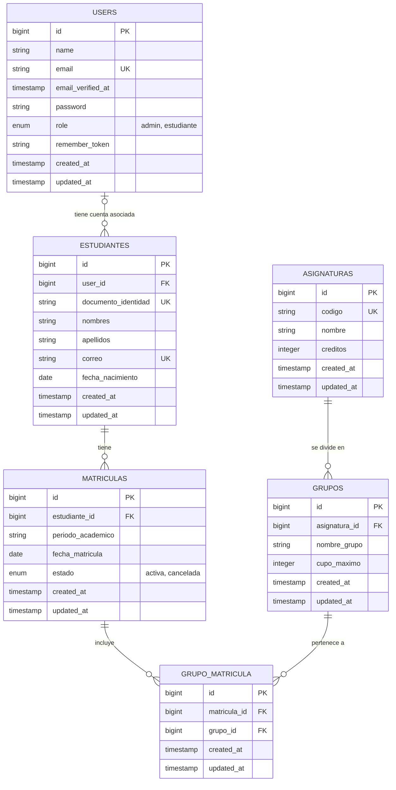

# Diagrama Entidad-Relación (ER)

A continuación se presenta el modelo entidad-relación de la base de datos diseñado para el Sistema de Gestión de Matrículas. El diagrama representa las entidades principales, sus atributos, claves primarias, claves foráneas, restricciones y cardinalidades de acuerdo con la estructura implementada mediante las migraciones de Laravel.

## Diagrama Entidad-Relación

## Descripción de las Entidades

**1. USERS:** Almacena las cuentas de acceso al sistema. Contiene las credenciales de autenticación, el correo electrónico y el rol asignado a cada usuario. Los roles implementados son `admin` y `estudiante`.

**2. ESTUDIANTES:** Almacena la información personal y académica básica de los estudiantes. Se relaciona con la tabla `USERS` mediante el campo `user_id`, que permite asociar el perfil académico con su cuenta de acceso. Este campo admite valores nulos.

**3. ASIGNATURAS:** Contiene el catálogo de asignaturas disponibles en el sistema. Cada asignatura posee un código único, nombre y cantidad de créditos académicos.

**4. GRUPOS:** Representa los grupos académicos asociados a una asignatura. Cada grupo tiene un nombre y una capacidad máxima de estudiantes establecida mediante el atributo `cupo_maximo`.

**5. MATRICULAS:** Registra las matrículas realizadas por los estudiantes. Almacena la identificación del estudiante, el periodo académico, la fecha de matrícula y el estado del registro, que puede ser `activa` o `cancelada`.

**6. GRUPO_MATRICULA:** Es la tabla pivote que permite establecer la relación de muchos a muchos entre las matrículas y los grupos académicos. Cada registro vincula una matrícula con un grupo específico.

## Descripción de las Relaciones

- **USERS - ESTUDIANTES:** Permite asociar una cuenta de usuario con un perfil de estudiante mediante el campo `user_id`. La relación permite que los estudiantes accedan al sistema utilizando las credenciales de su cuenta.

- **ESTUDIANTES - MATRICULAS:** Un estudiante puede tener varias matrículas registradas a lo largo de diferentes periodos académicos, mientras que cada matrícula pertenece a un único estudiante.

- **ASIGNATURAS - GRUPOS:** Una asignatura puede tener varios grupos académicos disponibles, pero cada grupo pertenece a una sola asignatura.

- **MATRICULAS - GRUPO_MATRICULA:** Una matrícula puede estar asociada a uno o varios grupos mediante los registros de la tabla pivote.

- **GRUPOS - GRUPO_MATRICULA:** Un grupo puede estar relacionado con múltiples matrículas, permitiendo controlar qué estudiantes se encuentran inscritos en él.

## Consideraciones del Modelo

- Las claves primarias identifican de forma única cada registro de las entidades.
- Las claves foráneas garantizan las relaciones entre usuarios, estudiantes, asignaturas, grupos y matrículas.
- Los campos `documento_identidad`, `correo`, `email` y `codigo` cuentan con restricciones de unicidad.
- El campo `user_id` de la tabla `ESTUDIANTES` es nullable, permitiendo que un perfil de estudiante exista sin una cuenta de acceso asociada.
- La disponibilidad de cupos de los grupos se obtiene considerando el valor de `cupo_maximo` y la cantidad de matrículas asociadas. No existe una columna independiente denominada `cupo_disponible` en la tabla `GRUPOS`.
- La tabla `GRUPO_MATRICULA` utiliza las claves foráneas `matricula_id` y `grupo_id` para establecer la asociación entre las matrículas y los grupos.
- Las tablas principales utilizan campos de auditoría temporal `created_at` y `updated_at`, administrados por Laravel.